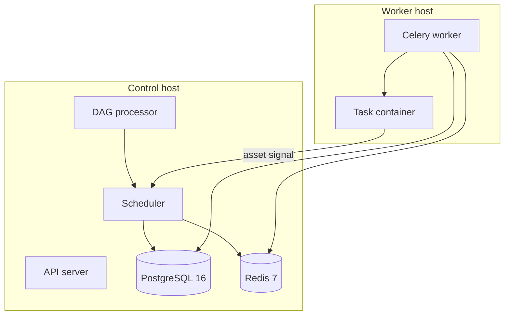

# Orchestrating data automations with Airflow 3

## Context

Forty-two production DAGs cover collection, calculation, integration, reporting, and approval. They run on Apache Airflow 3. I maintain all of them and built several.

A job is a DAG. Work inside a job runs in its own container, on a worker host separate from the scheduler. When one job has produced new data, an asset signal can start the next job.

## My role

I am an intern on a small team.

I maintain all of the production DAGs and built several. I built the helper that starts each task container, and the loader that supplies configuration when the task starts. The platform around the scheduler is described in [Infrastructure and observability](../infrastructure-observability/README.md). How the tasks reach external systems is described in [Integrations](../integrations/README.md).

## Problem

Jobs run on weekdays, in an explicit order. A downstream job has to start when an upstream job publishes an asset, including when upstream tasks were skipped because there was nothing to do. A task that finds the source already up to date has to be skipped, and the asset still has to publish when nothing in the chain failed.

## Architecture

The control host parses DAGs and decides what is due. Redis 7 carries the due work to a Celery worker on the second host. The worker starts a short-lived container for the task. The container writes a small JSON payload on standard output; the helper stores it for the next task. On success of the whole chain, the DAG publishes an asset, and downstream DAGs that depend on it become due.

## Key technical decisions

### Run task code in its own container

**Decision.** A wrapper around Airflow's Docker operator starts one container per task. The image carries the browser and the database driver. The worker process only starts that container.

**Instead of.** Run the task code inside the Celery worker, as a normal Python task.

**Why.** Browser and driver libraries do not belong on the scheduler or the worker. Parsing a DAG file must also stay cheap: heavy libraries load only when the container actually runs. A dedicated process exit code means "nothing to do". The helper marks that task skipped, so a quiet day is not a failure.

### Load configuration when the task starts

**Decision.** The worker reads Airflow configuration at execution and injects it into the container environment. The task process reads those variables. It does not open Airflow's metadata database.

**Instead of.** Read configuration while the DAG file is imported.

**Why.** Opening configuration for every DAG during parsing made the DAG processor time out. Doing it at execution keeps parsing fast, and a configuration change applies on the next run without a process recycle.

### Celery on a second host

**Decision.** CeleryExecutor, Redis 7 as the transport, PostgreSQL 16 as the metadata database and the Celery result store. The worker runs in its own Compose project and calls the control host for metadata, transport, and the execution API.

**Why.** Collection and browser work is bursty. Keeping it on the worker host leaves the scheduler, the DAG processor, and the database on the control host.

### Start the next job from an asset

**Decision.** The last step of a DAG publishes an asset when the chain succeeds, including when upstream tasks were skipped because there was nothing to do. Downstream DAGs are scheduled on that asset.

**Why.** The next job should run when new data exists, including after the upstream DAG is run again by hand. A clock cannot tell that run from a day with no new data.

### Register a custom timetable as a plugin

**Decision.** Jobs that run only inside a weekday window use a timetable class registered by an Airflow plugin. If the next slot is already in the past, the timetable schedules one run at the current time.

**Instead of.** One cron expression for that weekday window.

**Why.** Airflow serializes a custom timetable only when a plugin registers it. The window ends in the middle of the hour, so it does not fit one cron expression.

## Challenges and solutions

**DAG parsing timed out.** Heavy imports and configuration reads happened while the DAG bag was loading. Imports of the task stack now wait until the container runs, and configuration is read in the operator's execute step.

**Results had to cross a container boundary.** The task prints one JSON object. The operator pushes that object for the next task. A directory keyed by DAG id keeps two DAGs with the same task id from sharing files.

**A quiet day looked like a failure.** The task exits with a dedicated code when the source is already up to date. The operator treats that code as a skip. The final step still publishes the asset if nothing in the chain failed.

## Stack

Apache Airflow 3, CeleryExecutor, Redis 7, PostgreSQL 16, Docker.
