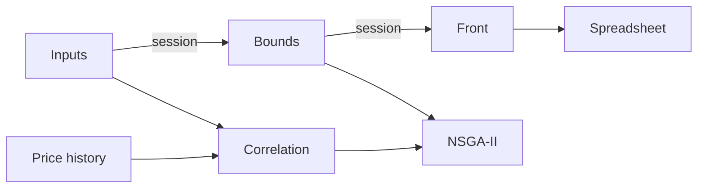

# Efficient frontier

## Context

We build a Pareto front of portfolio weights: higher expected return against lower risk, with a floor and a cap on each group and a floor and a cap on each name inside its group. The search is a custom NSGA-II. We serve it through Django REST. The Next.js screens collect prices, edit the bounds, and draw the front.

## My role

I co-developed this with another engineer on a small team.

## Problem

The screen needs the non-dominated front: portfolios of expected return against risk. One optimized portfolio is a single point on that front. Each group has a floor and a cap. Each name has a floor and a cap as a share of its group, and some names are pinned to a fixed share of the group.

## Architecture

We keep inputs, bounds, and the last front in the browser session, so a bound can change without reloading prices. Three calls do the work. We turn a price history into a correlation matrix and a risk and expected return per name. We run the optimizer. We write the chosen front to a spreadsheet. Non-dominated sorting comes from pymoo. The rest of the generation loop is local NumPy.

## Key technical decisions

### Search the front with NSGA-II

**Decision.** We maintain a population of feasible weights with a custom NSGA-II. Each generation sorts the population into non-dominated fronts, prefers sparse regions of the current front, crosses and mutates parents, and inserts a few new feasible portfolios so the front does not collapse.

### Draw feasible weights, then repair

**Decision.** We draw a new portfolio group-first. Group weights land inside the group floor and cap and sum to one. Inside a group, names that are pinned to a fixed share are set aside, and the remaining names share what is left. After crossover and mutation, we write pinned names back and the residual stays inside the group. A child that is still outside the bounds is replaced by a new feasible portfolio.

**Why.** Crossover and mutation can place a weight outside a floor or a cap. Drawing the group weights inside the bounds, and writing pinned names back after each operator, keeps the child inside those bounds.

### Repair the covariance before scoring risk

**Decision.** We build covariance from the correlation matrix scaled by the outer product of the per-name standard deviations, then force it to be symmetric. Two optional repairs follow. One sets negative eigenvalues to zero, which is the nearest positive-semidefinite matrix in that spectral sense. The other shrinks the sample matrix toward a scaled identity, a convex mix that pulls extreme entries in when the history is short relative to the number of names.

**Instead of.** Score risk with the raw sample covariance.

**Why.** Portfolio risk is a square root of a quadratic form. A negative eigenvalue makes that value imaginary. A short window with many names also overfits the sample matrix. The two repairs are switches, chosen per run.

### Keep a second search for a target point

**Decision.** We order the first non-dominated front by risk and use that as the frontier result. A second run aims at a target risk, a target expected return, or both. That run keeps the best weight from the previous generation and fills the rest by crossover and mutation.

**Why.** Filling a front and chasing a point are different selections. Crowding distance spreads the front. Elitism holds a point still while the rest of the population moves toward the target.

### Split the client into three pages

**Decision.** We split inputs, bounds, and the front into three pages. The browser session holds the correlation and the last result. The front page can export a spreadsheet.

**Why.** Loading the price history dominates the wait. Editing a floor or a cap should rerun the optimizer only.

## Challenges and solutions

**Crossover left the policy.** A blend of two feasible parents is not feasible once a name is pinned to its group. We write those names back. If the child still breaks a floor or a cap, we discard it and a new feasible portfolio takes its place.

**Risk was not a real number.** A short or inconsistent history produced a covariance with negative eigenvalues. We set those eigenvalues to zero before any weight is scored.

**The sample covariance overfit a crowded universe.** We can shrink the sample matrix toward a scaled identity. It is a mix with the sample matrix, not a replacement of the correlation supplied with the prices.

**The front collapsed onto a few weights.** We select with crowding distance, and each generation adds a few random feasible portfolios so later generations still see other regions.

## Stack

Python, NumPy 2, pandas 2, pymoo 0.6, Django 5, Django REST Framework 3, Next.js 14, React 18, MUI 5, ECharts 5.
