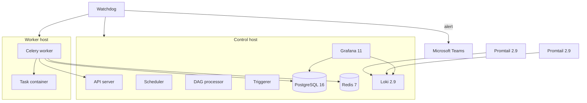

# Infrastructure and observability

## Context

The Airflow control plane and the Celery worker run as two Docker Compose stacks, on two hosts. Logs from both hosts land in one place. A watchdog outside Docker's restart policy watches the stacks and alerts Microsoft Teams.

The jobs themselves are the [42 production DAGs](../airflow-orchestration/README.md).

## My role

I am an intern on a small team.

I built the watchdog. I built the loader that turns stored configuration into the environment of a task container. I changed the log pipeline so a label per file could not exhaust the log store. I maintain all of the production DAGs on this platform, and I built several of them.

## Problem

The scheduler and the worker do not share a host. After a reboot, a stopped engine, or a container that stays up while its health check fails, Docker's restart policy does not restore the stack. During a failure, logs are split across the two hosts and across containers that disappear when the task ends.

## Architecture

Control runs the Airflow 3 services: API server, scheduler, DAG processor, and triggerer, plus PostgreSQL 16 and Redis 7. The worker Compose runs the Celery worker and a Promtail 2.9 process. A second Promtail runs on the control host. Grafana 11 reads Loki for logs and PostgreSQL for run state. The watchdog runs on a schedule on each host.

## Key technical decisions

### Split control and worker

**Decision.** Two Compose projects. The control host holds metadata, Redis, the scheduler, and the log store. The worker host runs Celery and starts task containers.

**Why.** Task work is bursty and pulls in a browser and a database driver. The scheduler, the DAG processor, and PostgreSQL stay on the control host. The worker reaches PostgreSQL, Redis, and the execution API over the network.

### Keep the browser stack out of the Airflow image

**Decision.** Airflow services use the standard Airflow 3 image. Task containers use a separate image: Python 3.11 and Firefox ESR.

**Why.** The scheduler does not need a browser. A task image can change driver versions without touching the control plane. The worker only has to start the container.

### Ship logs to Loki from both hosts

**Decision.** Promtail 2.9 on each host pushes to Loki 2.9 on the control host. Grafana 11 is the query UI. One dashboard reads task and scheduler logs. Another reads run state from PostgreSQL through a read-only connection.

**Why.** The worker is a different machine, and task containers are removed when they finish. A single query has to cover both hosts. Run state already lives in the metadata database, so the dashboard does not have to infer success from log text.

### Watch the stack beside Docker's restart policy

**Decision.** A scheduled watchdog on each host. It starts services that are missing, and it restarts a service that is unhealthy once the boot grace period has passed. Repeated restarts in a short window stop, and the watchdog sends a Microsoft Teams message. Further messages for the same condition wait out a cooldown. It does not restart task containers. On the worker, if the control host cannot be reached, it does not restart the worker.

**Instead of.** Rely on `restart: always` alone.

**Why.** That policy does not bring a stack back when the engine itself was down after a reboot. It also does not treat "up but unhealthy" as a problem, and it would be the wrong tool for a one-shot task container. Restarting the worker while the control host is unreachable only flaps the worker.

## Challenges and solutions

**Loki rejected log streams with HTTP 429.** A label taken from the file path opened one stream per task file and crossed Loki's stream limit. The pipeline now drops that label and keeps a series per job and per host.

**A health check fails while the process is still starting.** The watchdog ignores an unhealthy container during a boot grace period, so a slow API server is not restarted in a loop.

**The worker can look dead when the control host is the real outage.** The worker watchdog checks that the control host is reachable before it restarts anything. If the control host is down, it alerts and leaves the worker as it is.

**Task containers must not be swept up in a stack repair.** The watchdog's service list is the Compose services of the control plane or of the worker. Containers started by the Docker operator are outside that list.

## Stack

Docker Compose, Apache Airflow 3, PostgreSQL 16, Redis 7, Grafana 11, Loki 2.9, Promtail 2.9, Microsoft Teams, Python 3.11, Firefox ESR.
