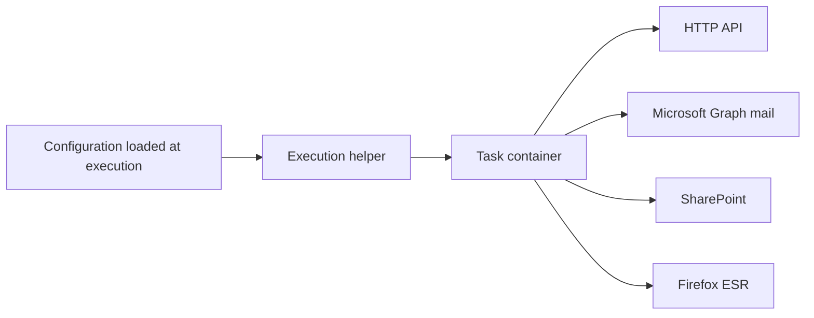

# Integrations

## Context

The [production DAGs](../airflow-orchestration/README.md) read and write external systems in three ways: an HTTP API, Microsoft 365 (mail and SharePoint), and a website that has no API. The browser path runs in the task image, not in the Airflow worker.

## My role

I am an intern on a small team.

I maintain the production DAGs that use these paths, and I built several of them. I built the helper that starts the task container and injects configuration at execution.

## Problem

The jobs call three kinds of system: an HTTP API, Microsoft 365 mail and SharePoint, and a website with no API. Two jobs can start together and log in as the same user. The identity provider rejects the second concurrent login. Configuration is read when the task starts. Reading it while the DAG file is imported times out the DAG processor, and the task image does not open Airflow's metadata database.

## Architecture

The helper runs on the Celery worker. It reads configuration, starts the container, and mounts the task file plus the shared libraries into that container. The container calls HTTP, Microsoft Graph, or SharePoint, or it drives Firefox through Selenium. A selector fix is a change to the mounted file, so the Airflow image stays as it is.

## Key technical decisions

### Put the browser in the task image

**Decision.** Browser work uses a task image with Python 3.11 and Firefox ESR. The Airflow services stay on the standard Airflow 3 image.

**Why.** The worker's job is to start containers. Browser and driver versions then ship with the task image, and a page-selector change is a file mounted into the container.

### Use HTTP or Microsoft 365 when the system has an API

**Decision.** HTTP where the system exposes it. Microsoft Graph for mail. SharePoint for files. Firefox only for sites that have no API.

**Why.** Page markup changes and breaks selectors. An HTTP or Graph call fails in a way the task can check. The browser is the fallback, not the default.

### Sign in once and reuse the session

**Decision.** A lock serializes the interactive login. A valid session is reused.

**Instead of.** Let every parallel task open its own login.

**Why.** The identity provider rejects a second concurrent login for the same user.

### Inject configuration at execution

**Decision.** The worker reads Airflow configuration in the operator's execute step and passes a private environment into the container. Task code reads environment variables only.

**Why.** Calling Airflow's variable store from inside the task container boots Airflow's database layer inside an image that does not hold a working metadata connection. Reading variables during DAG import also made parsing time out. Execution-time injection does both jobs: parsing stays light, and the task never opens the metadata database.

## Challenges and solutions

**Two jobs log in together.** Two jobs often start together and both need the same user. A lock serializes the interactive login, and a valid session is reused.

**The task image must not import Airflow.** The helper hands in environment variables, including the previous task's payload. The container prints its own JSON result for the next task. Airflow stays on the worker.

**A website change should not require a new Airflow image.** The task file and the shared library directory are mounted into the container. A selector or request change is a new revision of those files.

## Stack

Python 3.11, Requests, Microsoft Graph, SharePoint, Selenium, Firefox ESR, Apache Airflow 3, Docker.
