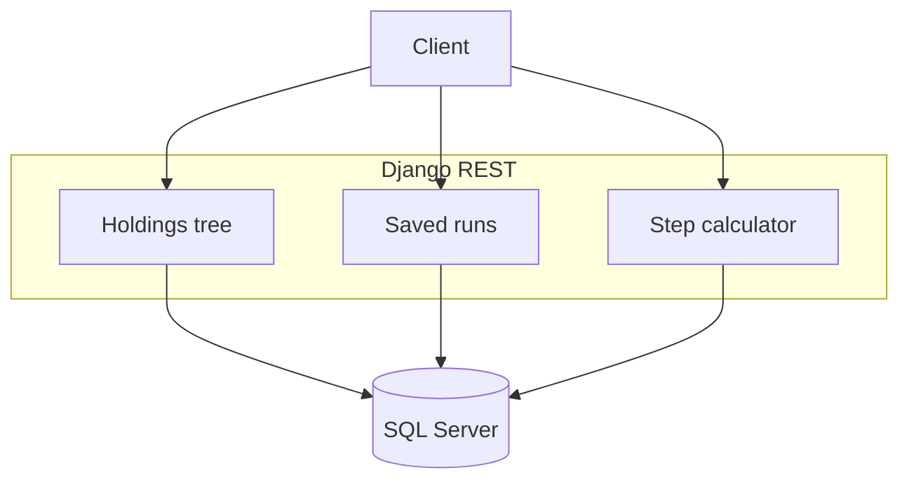

# Portfolio monitoring API

## Context

We turn a flat holdings extract into a tree: class, subclass, then name. Weight rolls up by summing the rows below. Performance at a subclass is the weight-weighted performance of its names, and performance at a class is the weight-weighted performance of its subclasses. We attach three limit layers to each class and each subclass. We restate a period figure on a business-day calendar, as a month or as a year.

A second API fills a hypothetical position in steps.

## My role

I co-developed this with another engineer on a small team.

## Problem

The extract is one row per name. The monitoring response has to roll that list into classes and subclasses, attach three limit layers to each bucket, and restate performance from a business-day count.

## Architecture

The monitoring call takes a portfolio and a date window. We count business days in that window, restate each name, then group the frame. We read limit rows for the class and for the subclass. A separate call lists stored snapshots. The step calculator answers in two passes: subclass weights first, then the names inside each subclass. A pass can start from the current weights, from equal weights, or from a blank form.

## Key technical decisions

### Group in the API

**Decision.** We return the monitoring response as a tree. Class weight is the sum of its rows. Subclass performance is the weight-weighted performance of its names. Class performance is the weight-weighted performance of its subclasses.

**Why.** The screen's question is whether a bucket sits inside its limits. One grouping on the server keeps that comparison the same for every client.

### Restate the window on a business-day calendar

**Decision.** We count business days between the two dates and restate the period figure as a month or as a year from that count.

**Instead of.** Divide by calendar days, or by a fixed 30 and 365.

**Why.** The window is a market calendar. A month with holidays is not thirty calendar days, and every name in the tree has to use the same count.

### Attach limits to the class and the subclass

**Decision.** We hang three limit layers on the class and on the subclass. A name does not carry its own copy.

**Why.** The policy is written for the bucket. The name inherits the comparison of the class and subclass it sits in.

## Challenges and solutions

**A class label arrived with a trailing control character.** The same class then grouped twice, and the limit lookup missed both. We strip that character before summing weights or reading limits.

**A window can contain no business days.** We treat that count as an empty window instead of raising on a zero exponent.

## Stack

Django 5, Django REST Framework 3, pandas 2, NumPy 2, SQL Server.
